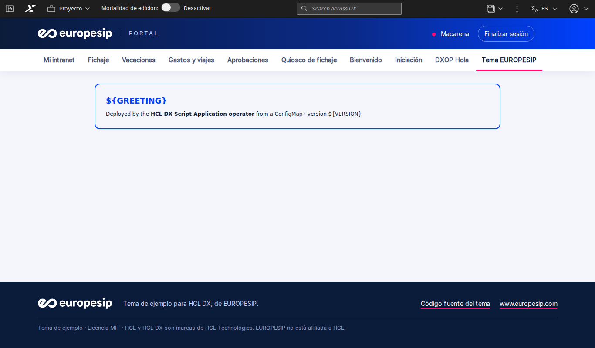

# Tema de ejemplo para HCL DX · EUROPESIP

[English](README.md)

**Un tema de ejemplo para HCL Digital Experience (DX Compose y DX 9.5), con los colores corporativos y el logo de
EUROPESIP. Escrito desde cero: plantillas, layouts, hoja de estilos y módulo de tema propios. Úsalo para ver cómo se
construye un tema de DX, como punto de partida del tuyo o para probar los temas del
[operador de Script Applications de HCL DX](https://github.com/europesip/hcl-dx-scriptapp-operator).**



> Es un **ejemplo**: muestra la estructura de un tema WebDAV y un diseño limpio y adaptable. No es un producto ni tiene
> soporte de HCL. HCL y HCL DX son marcas de HCL Technologies; EUROPESIP no está afiliada a HCL.

## Qué contiene

La carpeta `theme/` es el tema tal cual va al almacén WebDAV de DX (`dav:fs-type1/themes/<carpeta>/`):

| Fichero | Qué es |
|---|---|
| `theme.html`, `nls/theme_en.html`, `nls/theme_es.html` | La plantilla de la página: cabecera con el logo, usuario y cierre de sesión, navegación principal, migas de pan, el layout de la página y el pie. DX muestra la versión del idioma del usuario (`theme.html` enlaza a ellas) |
| `css/europesip.css` | Todo el diseño: colores, navegación, layouts, los skins de las aplicaciones y el pie. El logo va incrustado, así que funciona se llame como se llame la carpeta |
| `contributions/europesip.json` | El módulo de tema `europesip_theme`: la hoja de estilos, sobre los módulos del framework de cliente de DX |
| `profiles/profile_europesip.json` | Los módulos que carga cada página (barra de herramientas, dynamic content spots, estilos de portlets…) y los que solo se cargan al editar una página |
| `layout-templates/*/layout.html` | Cuatro layouts: una columna, dos y tres columnas iguales, y una fila sobre dos columnas (2/3 + 1/3) |
| `images/` | Los logos de EUROPESIP |

La plantilla usa los **dynamic content spots** de DX (`dyn-cs:id:85theme_*`: barra de herramientas, acciones del
usuario, navegación, migas, mensajes, layout). Son parte de DX, así que el tema no copia ningún fichero de los temas de
HCL. Los skins de las aplicaciones son los de DX (Standard, No Skin…), con el estilo de `europesip.css`.

`src/` tiene las fuentes: `tools/build.py` genera `theme/` a partir de ellas (las plantillas de cada idioma y la hoja
de estilos con el logo incrustado). Ejecútalo tras cambiar `src/` y sube los dos.

## Instalarlo con el operador (recomendado)

Con el [operador de Script Applications de HCL DX](https://github.com/europesip/hcl-dx-scriptapp-operator) 0.3.0 o
posterior y una `DXConnection` a tu DX, aplica [operator/dxtheme.yaml](operator/dxtheme.yaml):

```yaml
apiVersion: dx.europesip.com/v1alpha1
kind: DXTheme
metadata:
  name: europesip
spec:
  connectionRef: { name: dx }
  uniqueName: europesip.theme.sample
  titles: { en: "EUROPESIP", es: "EUROPESIP" }
  base: { copyFiles: false }        # un tema propio: no se copia nada de otro tema
  source:
    url:
      url: https://github.com/europesip/hcl-dx-theme-sample/archive/refs/tags/v1.0.0.tar.gz
      path: hcl-dx-theme-sample-1.0.0/theme
  profile: profiles/profile_europesip.json
  layout: layout-templates/1Column
```

El operador sube la carpeta por WebDAV y registra el tema con XMLAccess (toma como modelo el registro del tema Portal
8.5: skins y ajustes, con esta carpeta, este perfil y este layout). Las páginas lo usan con
`theme: europesip.theme.sample` (y `layoutTemplate: dav:fs-type1/themes/europesip/layout-templates/1Column`). Funciona
con el login propio de DX y detrás de OpenID Connect (Keycloak…). Probado con HCL DX Compose CF239.

## Instalarlo a mano

1. Sube el contenido de `theme/` a una carpeta nueva del almacén WebDAV de DX, por ejemplo
   `https://<host-de-dx>/wps/mycontenthandler/dav/fs-type1/themes/europesip/` (cualquier cliente WebDAV: DXClient,
   Cyberduck, la unidad de red de Windows…).
2. Registra el tema: exporta con XMLAccess el registro del tema Portal 8.5
   (`<theme action="export" uniquename="ibm.portal.85Theme"/>`) e impórtalo como un tema nuevo con otro nombre único, el
   parámetro `com.ibm.portal.theme.template.ref` con `dav:fs-type1/themes/europesip/` y `resourceaggregation.profile`
   con `profiles/profile_europesip.json`. Consulta
   [Themes and skins](https://help.hcl-software.com/digital-experience/9.5/latest/build_sites/themes_skins/) en la
   documentación de HCL.
3. Asigna el tema a una página (propiedades de la página, o el `theme` de una `DXPage`).

## Hazlo tuyo

- Colores: las variables del principio de `src/europesip.css` (`--esip-navy`, `--esip-blue`, `--esip-pink`…).
- Logo: sustituye `theme/images/europesip-white.png` (un logo blanco para la cabecera oscura) y ejecuta
  `python3 tools/build.py`.
- Textos de la cabecera y del pie: `TEXT` en `tools/build.py` (una entrada por idioma).
- Más layouts: `layouts` en `tools/build.py`.

## Limitaciones

- El **menú de acciones** de la página y los menús de los skins necesitan el módulo de menús de los temas de HCL; este
  ejemplo los oculta (autores y administradores tienen la barra de herramientas de DX).
- El **modo edición** de las páginas carga los módulos de edición de DX desde el perfil; la edición compleja (arrastrar
  aplicaciones) es mejor hacerla con los temas de HCL.
- No hay estilos para idiomas de derecha a izquierda.

## Licencia

[MIT](LICENSE) · © 2026 EUROPESIP · [www.europesip.com](https://www.europesip.com)
