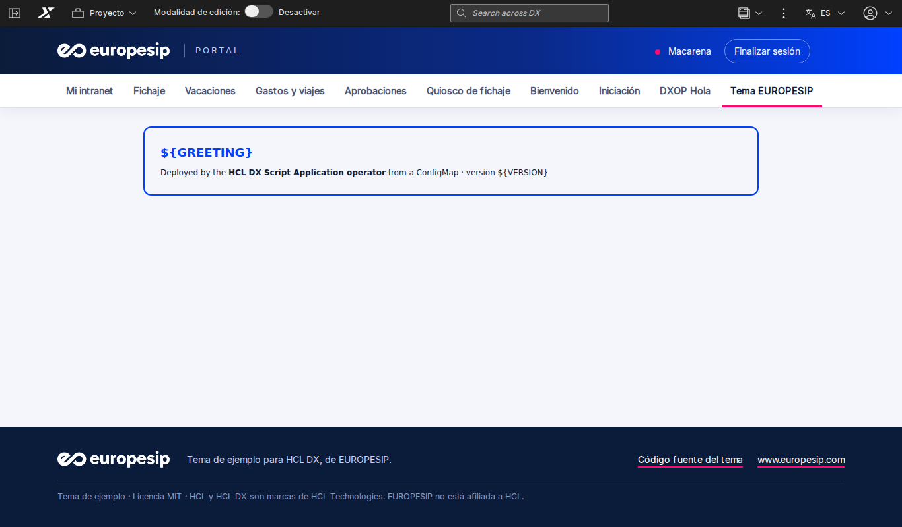

# HCL DX theme sample · EUROPESIP

[Español](README.es.md)

**A sample theme for HCL Digital Experience (DX Compose and DX 9.5), with the corporate colours and logo of EUROPESIP.
Written from scratch: templates, layouts, stylesheet and theme module of its own. Use it to see how a DX theme is built,
as a starting point for yours, or to try the theme support of the
[HCL DX Script Application operator](https://github.com/europesip/hcl-dx-scriptapp-operator).**



> This is a **sample**: it shows the structure of a WebDAV theme and a clean, responsive design. It is not a product
> and it is not supported by HCL. HCL and HCL DX are trademarks of HCL Technologies; EUROPESIP is not affiliated with HCL.

## What is inside

The `theme/` folder is the theme exactly as it goes to the WebDAV store of DX (`dav:fs-type1/themes/<folder>/`):

| File | What it is |
|---|---|
| `theme.html`, `nls/theme_en.html`, `nls/theme_es.html` | The page template: header with the logo, user and log out, main navigation, crumb trail, the layout of the page and the footer. DX renders the version of the language of the user (`theme.html` links to them) |
| `css/europesip.css` | The whole design: colours, navigation, layouts, the skins of the applications and the footer. The logo is embedded, so the stylesheet works whatever the folder name is |
| `contributions/europesip.json` | The theme module `europesip_theme`: the stylesheet, on top of the client framework modules of DX |
| `profiles/profile_europesip.json` | The modules every page loads (toolbar, dynamic content spots, portlet styles…) and the ones loaded only when a page is edited |
| `layout-templates/*/layout.html` | Four layouts: one column, two and three equal columns, and a row on top of two columns (2/3 + 1/3) |
| `images/` | The EUROPESIP logos |

The template uses the **dynamic content spots** of DX (`dyn-cs:id:85theme_*`: toolbar, user actions, navigation,
crumb trail, status messages, layout). They are part of DX, so the theme does not copy any file of the themes of HCL.
The skins of the applications are the skins of DX (Standard, No Skin…), styled by `europesip.css`.

`src/` holds the sources: `tools/build.py` builds `theme/` from them (the templates of every language and the
stylesheet with the logo embedded). Run it after changing `src/` and commit both.

## Install it with the operator (recommended)

With the [HCL DX Script Application operator](https://github.com/europesip/hcl-dx-scriptapp-operator) 0.3.0 or later
and a `DXConnection` to your DX, apply [operator/dxtheme.yaml](operator/dxtheme.yaml):

```yaml
apiVersion: dx.europesip.com/v1alpha1
kind: DXTheme
metadata:
  name: europesip
spec:
  connectionRef: { name: dx }
  uniqueName: europesip.theme.sample
  titles: { en: "EUROPESIP", es: "EUROPESIP" }
  base: { copyFiles: false }        # a theme of its own: nothing is copied from another theme
  source:
    url:
      url: https://github.com/europesip/hcl-dx-theme-sample/releases/download/v1.0.0/europesip-theme-1.0.0.tar.gz
      sha256: bcb2aaec16f7b7ded4562049d75e2969957c3de4d0262ef9a2ba47459d9ed0c9
  profile: profiles/profile_europesip.json
  layout: layout-templates/1Column
```

The operator uploads the folder over WebDAV and registers the theme with XMLAccess (it takes the registration of the
Portal 8.5 theme as the model: skins and settings, with this folder, this profile and this layout). Pages use it with
`theme: europesip.theme.sample` (and `layoutTemplate: dav:fs-type1/themes/europesip/layout-templates/1Column`). It works
with DX on its own login and behind OpenID Connect (Keycloak…). Tested with HCL DX Compose CF239.

## Install it by hand

1. Upload the content of `theme/` to a new folder of the WebDAV store of DX, for example
   `https://<dx-host>/wps/mycontenthandler/dav/fs-type1/themes/europesip/` (any WebDAV client: DXClient, Cyberduck,
   the network drive of Windows…).
2. Register the theme: export the registration of the Portal 8.5 theme with XMLAccess
   (`<theme action="export" uniquename="ibm.portal.85Theme"/>`), and import it as a new theme with another unique name,
   the parameter `com.ibm.portal.theme.template.ref` set to `dav:fs-type1/themes/europesip/`, and
   `resourceaggregation.profile` set to `profiles/profile_europesip.json`. See
   [Themes and skins](https://help.hcl-software.com/digital-experience/9.5/latest/build_sites/themes_skins/) in the HCL
   documentation.
3. Assign the theme to a page (page properties, or the `theme` of a `DXPage`).

## Make it yours

- Colours: the variables at the top of `src/europesip.css` (`--esip-navy`, `--esip-blue`, `--esip-pink`…).
- Logo: replace `theme/images/europesip-white.png` (a white logo for the dark header) and run `python3 tools/build.py`.
- Texts of the header and the footer: `TEXT` in `tools/build.py` (one entry per language).
- More layouts: `layouts` in `tools/build.py`.

## Limitations

- The **actions menu** of the page and the menus of the skins need the theme menus module of the HCL themes; this
  sample hides them (authors and administrators have the DX toolbar).
- **Edit mode** of pages loads the edit modules of DX through the profile; complex editing (drag and drop of
  applications) is best done with the HCL themes.
- Right-to-left languages are not styled.

## Licence

[MIT](LICENSE) · © 2026 EUROPESIP · [www.europesip.com](https://www.europesip.com)
