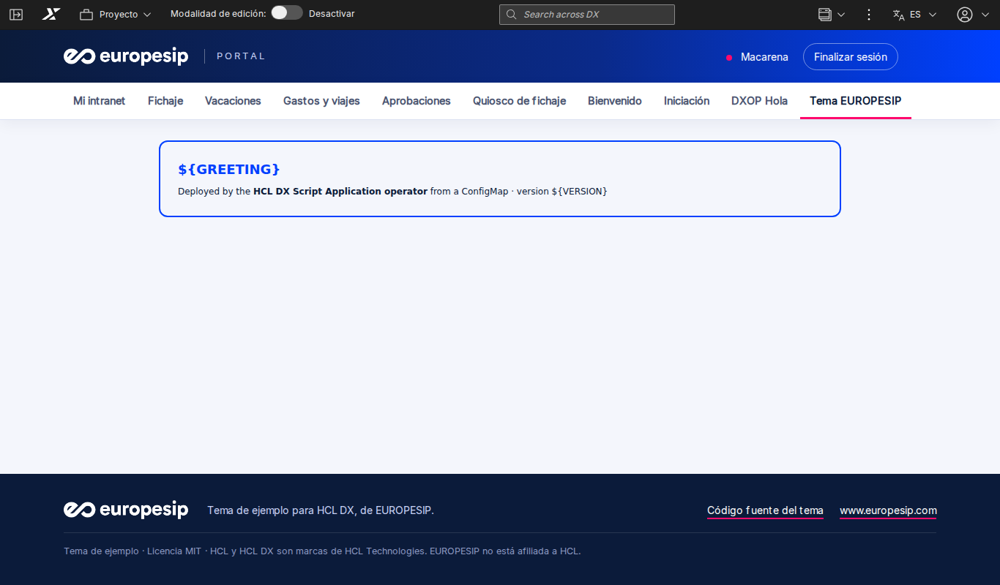

# Tema de ejemplo para HCL DX · EUROPESIP

[English](index.md) · **Español**

Un **tema de ejemplo para HCL Digital Experience** (DX Compose y DX 9.5), con los colores corporativos y el logo de
EUROPESIP. Escrito desde cero: plantillas, layouts, hoja de estilos y módulo de tema propios. Úsalo para ver cómo se
construye un tema de DX, como punto de partida del tuyo o para probar los temas del
[operador de Script Applications de HCL DX](https://github.com/europesip/hcl-dx-scriptapp-operator).

> Es un **ejemplo**: muestra la estructura de un tema WebDAV y un diseño limpio y adaptable. No es un producto ni tiene
> soporte de HCL. HCL y HCL DX son marcas de HCL Technologies; EUROPESIP no está afiliada a HCL.

> Esta página es el resumen para el portal del desarrollador. La guía completa (cada fichero, el recurso `DXTheme`, el
> registro a mano con XMLAccess) es el [README en GitHub](https://github.com/europesip/hcl-dx-theme-sample/blob/main/README.es.md).

## Qué contiene

| Carpeta | Qué es |
|---|---|
| `theme/` | El tema tal cual va al almacén WebDAV de DX (`dav:fs-type1/themes/<carpeta>/`): plantilla de la página (inglés y español), `css/europesip.css` (todo el diseño, con el logo incrustado), el módulo de tema `europesip_theme`, el perfil `profiles/profile_europesip.json` y cuatro layouts (una columna, dos y tres columnas iguales, una fila sobre dos columnas) |
| `src/` | Las fuentes: `tools/build.py` genera `theme/` a partir de ellas. Ejecútalo tras cambiar `src/` y sube los dos |
| `operator/` | [`dxtheme.yaml`](https://github.com/europesip/hcl-dx-theme-sample/blob/main/operator/dxtheme.yaml): el recurso `DXTheme` para el operador |

## Cómo funciona

- La plantilla usa los **dynamic content spots** de DX (`dyn-cs:id:85theme_*`: barra de herramientas, acciones del
  usuario, navegación, migas, mensajes, layout). Son parte de DX, así que el tema no copia ningún fichero de los temas
  de HCL.
- Los skins de las aplicaciones son los de DX (Standard, No Skin…), con el estilo de `europesip.css`.
- DX muestra la versión de la plantilla del idioma del usuario (`theme.html` enlaza a `nls/theme_en.html` y
  `nls/theme_es.html`).

## Requisitos

| | |
|---|---|
| **HCL DX** | DX Compose o DX 9.5. Funciona con el login propio de DX y detrás de OpenID Connect (Keycloak…); probado con HCL DX Compose CF239 |
| **Con el operador** | El [operador de Script Applications de HCL DX](https://github.com/europesip/hcl-dx-scriptapp-operator) 0.3.0 o posterior y un `DXConnection` a tu DX |
| **A mano** | Cualquier cliente WebDAV (DXClient, Cyberduck, la unidad de red de Windows…) y XMLAccess |

## Instalación, en resumen

**Con el operador (recomendado).** Aplica
[operator/dxtheme.yaml](https://github.com/europesip/hcl-dx-theme-sample/blob/main/operator/dxtheme.yaml): apunta al
archivo del tema de la versión publicada (`europesip-theme-1.0.0.tar.gz`, con su SHA256). El operador sube la carpeta
por WebDAV y registra el tema con XMLAccess, tomando como modelo el registro del tema Portal 8.5. Las páginas lo usan
con `theme: europesip.theme.sample` (y `layoutTemplate: dav:fs-type1/themes/europesip/layout-templates/1Column`).

**A mano.**

1. Sube el contenido de `theme/` a una carpeta nueva del almacén WebDAV de DX, por ejemplo
   `https://<host-de-dx>/wps/mycontenthandler/dav/fs-type1/themes/europesip/`.
2. Registra el tema: exporta con XMLAccess el registro del tema Portal 8.5 e impórtalo como un tema nuevo con otro
   nombre único, `com.ibm.portal.theme.template.ref` con `dav:fs-type1/themes/europesip/` y
   `resourceaggregation.profile` con `profiles/profile_europesip.json`.
3. Asigna el tema a una página (propiedades de la página, o el `theme` de una `DXPage`).

Paso a paso: [Instalarlo con el operador](https://github.com/europesip/hcl-dx-theme-sample/blob/main/README.es.md#instalarlo-con-el-operador-recomendado)
e [Instalarlo a mano](https://github.com/europesip/hcl-dx-theme-sample/blob/main/README.es.md#instalarlo-a-mano) en el
README.

## Hazlo tuyo

- Colores: las variables del principio de `src/europesip.css` (`--esip-navy`, `--esip-blue`, `--esip-pink`…).
- Logo: sustituye `theme/images/europesip-white.png` (un logo blanco para la cabecera oscura) y ejecuta
  `python3 tools/build.py`.
- Textos de la cabecera y del pie: `TEXT` en `tools/build.py` (una entrada por idioma).
- Más layouts: `layouts` en `tools/build.py`.

## Limitaciones

- El **menú de acciones** de la página y los menús de los skins necesitan el módulo de menús de los temas de HCL; este
  ejemplo los oculta (autores y administradores tienen la barra de herramientas de DX).
- El **modo edición** de las páginas carga los módulos de edición de DX desde el perfil; la edición compleja (arrastrar
  aplicaciones) es mejor hacerla con los temas de HCL.
- No hay estilos para idiomas de derecha a izquierda.

## Más

- Código, versiones e historial: [GitHub](https://github.com/europesip/hcl-dx-theme-sample) ·
  [Versiones](https://github.com/europesip/hcl-dx-theme-sample/releases) ·
  [Historial de versiones](https://github.com/europesip/hcl-dx-theme-sample/blob/main/CHANGELOG.md) (en inglés).
- [Themes and skins](https://help.hcl-software.com/digital-experience/9.5/latest/build_sites/themes_skins/) en la
  documentación de HCL.

Licencia: [MIT](https://github.com/europesip/hcl-dx-theme-sample/blob/main/LICENSE) · © 2026 EUROPESIP ·
[www.europesip.com](https://www.europesip.com)
