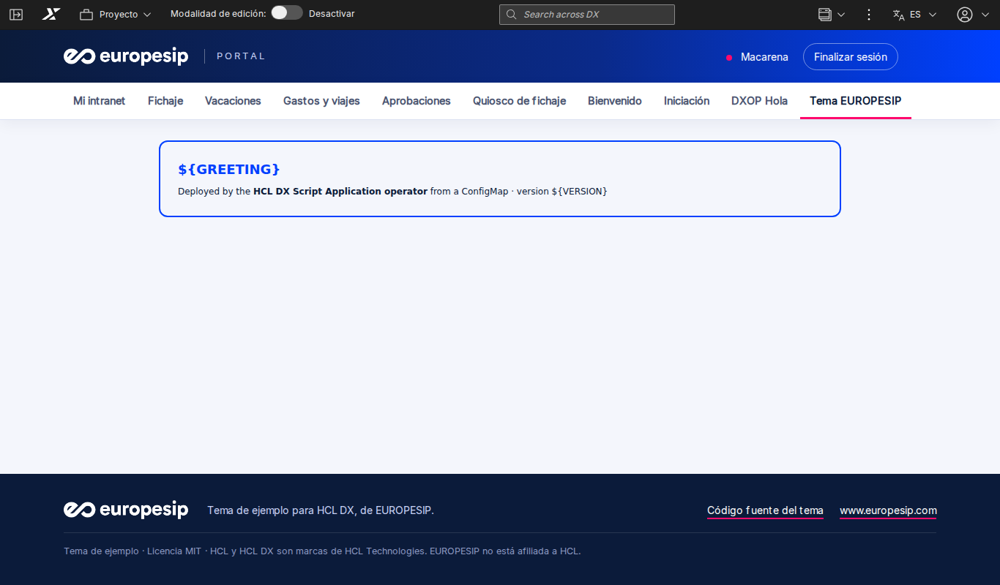

# HCL DX theme sample · EUROPESIP

**English** · [Español](index.es.md)

A **sample theme for HCL Digital Experience** (DX Compose and DX 9.5), with the corporate colours and logo of
EUROPESIP. Written from scratch: templates, layouts, stylesheet and theme module of its own. Use it to see how a DX
theme is built, as a starting point for yours, or to try the theme support of the
[HCL DX Script Application operator](https://github.com/europesip/hcl-dx-scriptapp-operator).

> This is a **sample**: it shows the structure of a WebDAV theme and a clean, responsive design. It is not a product
> and it is not supported by HCL. HCL and HCL DX are trademarks of HCL Technologies; EUROPESIP is not affiliated with HCL.

> This page is the summary for the developer portal. The full guide (every file, the `DXTheme` resource, the manual
> registration with XMLAccess) is the [README on GitHub](https://github.com/europesip/hcl-dx-theme-sample#readme).

## What is inside

| Folder | What it is |
|---|---|
| `theme/` | The theme exactly as it goes to the WebDAV store of DX (`dav:fs-type1/themes/<folder>/`): page template (English and Spanish), `css/europesip.css` (the whole design, logo embedded), the theme module `europesip_theme`, the profile `profiles/profile_europesip.json` and four layouts (one column, two and three equal columns, a row on top of two columns) |
| `src/` | The sources: `tools/build.py` builds `theme/` from them. Run it after changing `src/` and commit both |
| `operator/` | [`dxtheme.yaml`](https://github.com/europesip/hcl-dx-theme-sample/blob/main/operator/dxtheme.yaml): the `DXTheme` resource for the operator |

## How it works

- The template uses the **dynamic content spots** of DX (`dyn-cs:id:85theme_*`: toolbar, user actions, navigation,
  crumb trail, status messages, layout). They are part of DX, so the theme does not copy any file of the themes of HCL.
- The skins of the applications are the skins of DX (Standard, No Skin…), styled by `europesip.css`.
- DX renders the version of the template in the language of the user (`theme.html` links to `nls/theme_en.html` and
  `nls/theme_es.html`).

## Requirements

| | |
|---|---|
| **HCL DX** | DX Compose or DX 9.5. It works with DX on its own login and behind OpenID Connect (Keycloak…); tested with HCL DX Compose CF239 |
| **With the operator** | The [HCL DX Script Application operator](https://github.com/europesip/hcl-dx-scriptapp-operator) 0.3.0 or later and a `DXConnection` to your DX |
| **By hand** | Any WebDAV client (DXClient, Cyberduck, the network drive of Windows…) and XMLAccess |

## Install, in short

**With the operator (recommended).** Apply
[operator/dxtheme.yaml](https://github.com/europesip/hcl-dx-theme-sample/blob/main/operator/dxtheme.yaml): it points at
the theme archive of the release (`europesip-theme-1.0.0.tar.gz`, with its SHA256). The operator uploads the folder
over WebDAV and registers the theme with XMLAccess, taking the registration of the Portal 8.5 theme as the model. Pages
use it with `theme: europesip.theme.sample` (and
`layoutTemplate: dav:fs-type1/themes/europesip/layout-templates/1Column`).

**By hand.**

1. Upload the content of `theme/` to a new folder of the WebDAV store of DX, for example
   `https://<dx-host>/wps/mycontenthandler/dav/fs-type1/themes/europesip/`.
2. Register the theme: export the registration of the Portal 8.5 theme with XMLAccess and import it as a new theme
   with another unique name, `com.ibm.portal.theme.template.ref` set to `dav:fs-type1/themes/europesip/` and
   `resourceaggregation.profile` set to `profiles/profile_europesip.json`.
3. Assign the theme to a page (page properties, or the `theme` of a `DXPage`).

Step by step: [Install it with the operator](https://github.com/europesip/hcl-dx-theme-sample#install-it-with-the-operator-recommended)
and [Install it by hand](https://github.com/europesip/hcl-dx-theme-sample#install-it-by-hand) in the README.

## Make it yours

- Colours: the variables at the top of `src/europesip.css` (`--esip-navy`, `--esip-blue`, `--esip-pink`…).
- Logo: replace `theme/images/europesip-white.png` (a white logo for the dark header) and run `python3 tools/build.py`.
- Texts of the header and the footer: `TEXT` in `tools/build.py` (one entry per language).
- More layouts: `layouts` in `tools/build.py`.

## Limitations

- The **actions menu** of the page and the menus of the skins need the theme menus module of the HCL themes; this
  sample hides them (authors and administrators have the DX toolbar).
- **Edit mode** of pages loads the edit modules of DX through the profile; complex editing (drag and drop of
  applications) is best done with the HCL themes.
- Right-to-left languages are not styled.

## More

- Source, releases and history: [GitHub](https://github.com/europesip/hcl-dx-theme-sample) ·
  [Releases](https://github.com/europesip/hcl-dx-theme-sample/releases) ·
  [Release history](https://github.com/europesip/hcl-dx-theme-sample/blob/main/CHANGELOG.md).
- [Themes and skins](https://help.hcl-software.com/digital-experience/9.5/latest/build_sites/themes_skins/) in the HCL
  documentation.

Licence: [MIT](https://github.com/europesip/hcl-dx-theme-sample/blob/main/LICENSE) · © 2026 EUROPESIP ·
[www.europesip.com](https://www.europesip.com)
